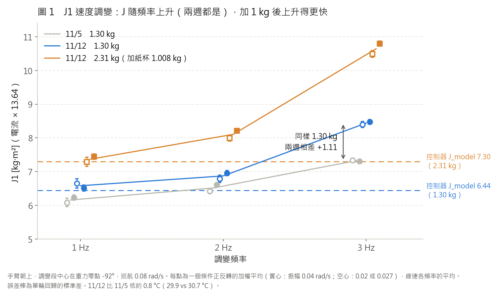
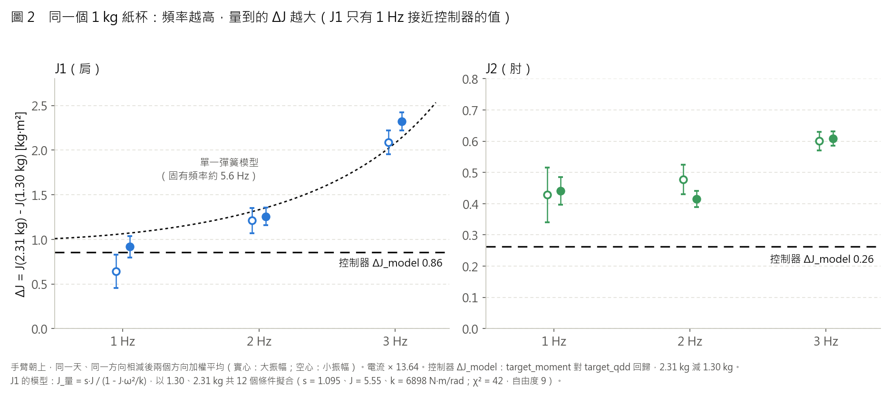
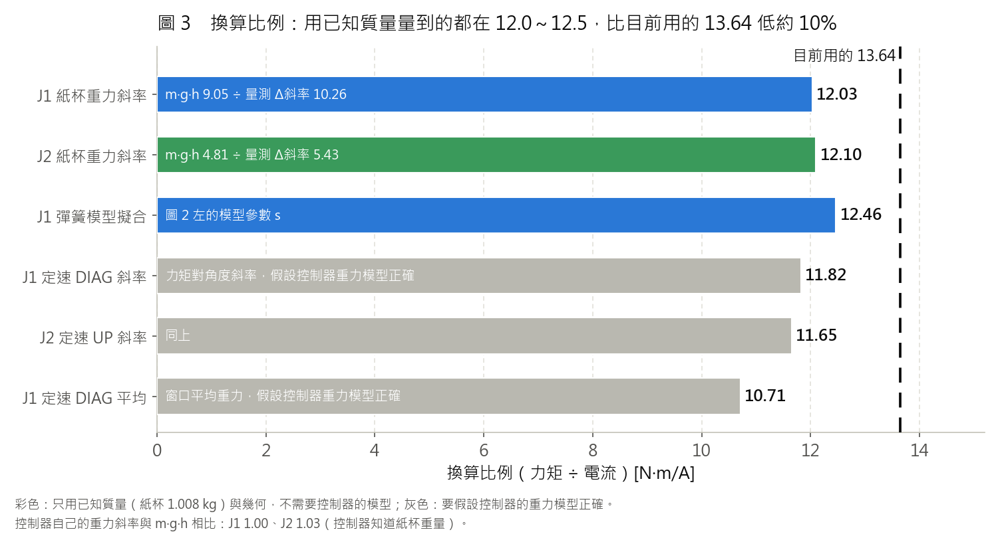
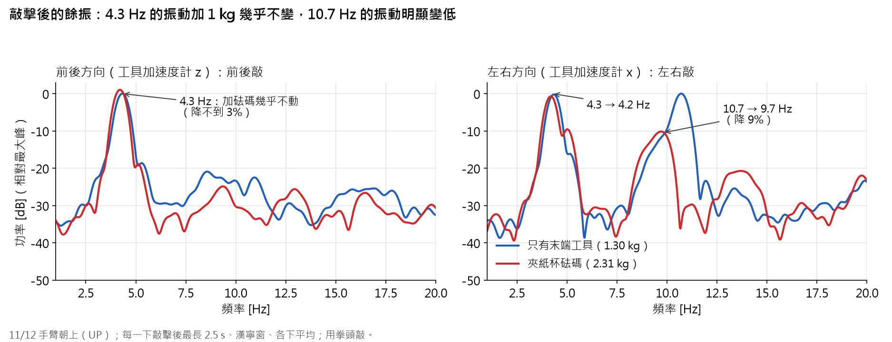
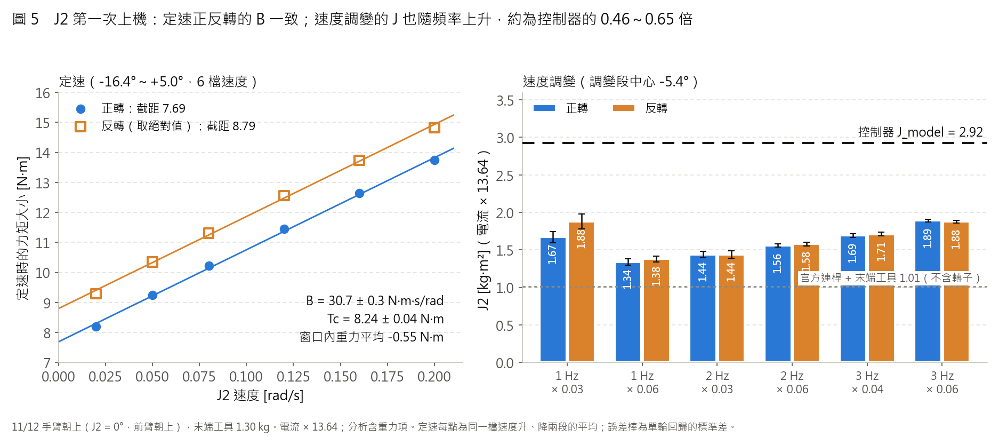

# 11/18 週報：11/12 上機結果（J1 重複、紙杯砝碼、J2 第一次、敲擊測試）

## 本週重點

1. **J1 的慣量隨頻率上升，兩週都看得到**。同樣 1.30 kg：1 Hz、2 Hz 與 11/5 相差約 +0.4，3 Hz 相差 +1.1（圖 1）。
2. **同一個 1 kg 紙杯，頻率越高量到的 ΔJ 越大**。J1 在 1 Hz 量到 0.64～0.92（控制器 0.86），3 Hz 量到 2.1～2.3（圖 2）。單一彈簧模型（固有頻率約 5.6 Hz）大致能解釋。J2 也一樣，而且 1 Hz 就已經是控制器的 1.7 倍。
3. **換算比例很可能比 13.64 低約 10%**。用已知質量的重力斜率量到 J1 12.03、J2 12.10（圖 3）。
4. **敲擊測試**：餘振主要在 4.3 Hz，加 1 kg 只降不到 3%；10.7 Hz 的振動降了 9%（圖 4）。和第 2 點的彈簧模型還對不起來，11/19 在 DIAG 再敲一次。
5. **J2 第一次上機**：
   - 定速 B 30.7 ± 0.3 N·m·s/rad、Tc 8.24 ± 0.04 N·m，正反轉的 B 一致。
   - 速度調變的 J 為 1.34～1.89，也隨頻率上升，約是控制器 J_model 2.92 的 0.46～0.65 倍（圖 5）。

## 11/12 做了什麼

除了 DIAG 的 J1 定速，其餘都在手臂朝上（UP）姿態。末端工具 1.30 kg；加紙杯砝碼 1.008 kg 時為 2.31 kg。

| 項目 | 姿態 | 負載 | 做了什麼 |
|------|------|------|----------|
| J1 定速 | DIAG | 1.30 | FULL 正反轉，與 11/5 UP 對照 |
| J1 定速 | UP | 1.30 | FULL 正轉 |
| J1 速度調變 | UP | 1.30、2.31 | FULL 正反轉，各一次（1.30 是 11/5 的重複） |
| J2 定速 | UP | 1.30 | FULL 正反轉（第一次） |
| J2 速度調變 | UP | 1.30、2.31 | FULL 正反轉，各一次（第一次） |
| 敲擊測試 | UP | 1.30、2.31 | 不敲、前後敲、左右敲（只記錄，不送指令） |

## 1. J1 速度調變：兩週重複，J 隨頻率上升

**各頻率的平均 J**（兩種振幅、兩個方向；電流 × 13.64）：

| | 1 Hz | 2 Hz | 3 Hz | 控制器 J_model |
|---|---|---|---|---|
| 11/5　1.30 kg | 6.16 | 6.51 | 7.32 | 6.44 |
| 11/12　1.30 kg | 6.58 | 6.87 | 8.44 | 6.44 |
| 11/12　2.31 kg | 7.37 | 8.10 | 10.64 | 7.30 |

- **兩週差多少**：1～2 Hz 比 11/5 高 0.3～0.4（2～3σ）。3 Hz 高 1.1（7～11σ），兩週對不上。
  - 3 Hz 的追隨增益（實際加速度振幅 ÷ 指令）也從 1.087 變成 1.11。
  - 11/12 的關節溫度比 11/5 低約 0.8 °C。
- **兩週一致的地方**：J 都隨頻率上升，正反轉一致；控制器的 J_model 兩週都是 6.44，不隨頻率變。
- J 隨頻率上升時，「J1 的慣量是多少」沒有單一答案，所以要先弄清楚上升的原因（第 2、4 點）。

## 2. 紙杯砝碼：ΔJ 隨頻率變大

**J1**：ΔJ = J(2.31) − J(1.30)，同一天、同方向相減。

| 條件 | 1 Hz × 0.02 | 1 Hz × 0.04 | 2 Hz × 0.02 | 2 Hz × 0.04 | 3 Hz × 0.027 | 3 Hz × 0.04 |
|---|---|---|---|---|---|---|
| ΔJ | 0.64 ± 0.19 | 0.92 ± 0.12 | 1.21 ± 0.14 | 1.26 ± 0.10 | 2.09 ± 0.13 | 2.32 ± 0.10 |

- 控制器的 ΔJ_model 是 0.86。從這個值反推，紙杯重心離法蘭約 56 mm，紙杯離 J1 軸 0.92 m，m·ρ² ≈ 0.86。
- 1 Hz 的 ΔJ 和控制器的值差不多，2 Hz 是 1.4 倍，3 Hz 是 2.5 倍。
- **單一彈簧模型**：馬達與連桿之間有彈性時，量到的慣量是 J_量 = J / (1 − J·ω²/k)，頻率越接近固有頻率越大，而且慣量越大的放大越多。
  - 用 1.30、2.31 kg 共 12 個條件一起擬合，得到 J = 5.55、k = 6898 N·m/rad、換算修正 s = 1.095。
  - 固有頻率 1.30 kg 為 5.6 Hz，2.31 kg 為 5.2 Hz。
  - χ² = 42（自由度 9），大致符合，不算完美。1 Hz 的模型值 1.06，比量測高。

**J2**：ΔJ 為 0.43（1 Hz）、0.45（2 Hz）、0.60（3 Hz）。控制器的 ΔJ_model 是 0.26，m·ρ² 約 0.26（紙杯離 J2 軸 0.51 m）。

- J2 也隨頻率上升，但 1 Hz 就已經是控制器的 1.7 倍；換算比例改成 12.1 也還有 1.5 倍。
- J2 的低頻偏高，單一彈簧模型解釋不了，原因還不清楚。

## 3. 換算比例：已知質量量到 12.0～12.5

- **做法**：手臂朝上時，紙杯造成的重力力矩對角度的斜率是 m·g·h，h 是紙杯在 J 軸上方的高度，只由質量與幾何決定。量到的電流斜率 × 13.64 再除以 m·g·h，就得到 13.64 要修正多少。
  - J1：m·g·h = 9.05 N·m/rad，量到 10.26（12 個條件的標準差 0.28）→ **12.03**。
  - J2：m·g·h = 4.81，量到 5.43（標準差 0.24）→ **12.10 ± 0.15**。
  - 控制器自己的重力斜率與 m·g·h 一致：J1 比值 1.00、J2 比值 1.03（控制器知道紙杯的重量）。
- **其他方法**：圖 2 的彈簧模型擬合得到 12.46。定速時力矩對角度的斜率（要假設控制器的重力模型正確）得到 11.65～11.82。
- **如果真的是 12.1**：所有用 13.64 算的 J、B、Tc 都要乘 0.887。
  - 例如 J1 1 Hz 的 6.58 會變成 5.84，比控制器的 6.44 低。
  - J0 的換算比例 13.64 是 10/29 用夾砝碼校正的，要不要重做，等 J1 低頻結果出來再決定。

## 4. 敲擊測試：4.3 Hz 加 1 kg 幾乎不變

- **4.3 Hz**：前後敲、左右敲的工具加速度都以 4.2～4.4 Hz 為主（阻尼比約 0.02～0.04）。加 1 kg 紙杯後只降到 4.2 Hz，不到 3%。
- **10.7 Hz**：左右敲時另有 10.7 Hz 的振動，加紙杯後降到 9.7 Hz，降 9%。
- **和第 2 點的關係**：彈簧模型預測，加紙杯後 J1 的固有頻率會從 5.6 降到 5.2 Hz（降 7%）。4.3 Hz 的振動幾乎不受紙杯影響，比較像底座或桌子；10.7 Hz 才像手臂本身。
- 所以「J 隨頻率上升是彈性造成的」還不能確定。
- 11/19 在 DIAG 再敲一次，如果 4.3 Hz 不隨姿態改變，就更可能是底座或桌子。

## 5. J2 第一次上機

**定速**：J2 從 −16.4° 掃到 +5.0°（6 個馬達圈，中心在重力零點附近），6 檔速度先升後降。

- B = 30.7 ± 0.3 N·m·s/rad（正轉 30.74、反轉 30.65）。
- Tc = 8.24 ± 0.04 N·m。
- 窗口內重力平均 −0.55 N·m，所以正、反轉的截距差 1.1 N·m。

**速度調變**：

- 正轉加權平均 J = 1.68 ± 0.01，反轉 1.71 ± 0.01，兩個方向一致。
- 各條件之間不一致（χ² 約 220～260，自由度 5）：
  - 大振幅時隨頻率上升（1.34 → 1.56 → 1.89）。
  - 1 Hz 小振幅偏高（1.67、1.88），誤差也大。
- 控制器 J_model = 2.92。量到的是它的 0.46～0.65 倍。
- 官方連桿 + 末端工具（不含轉子）是 1.01。J1 量到的 J 和控制器差不多（6.2～8.4 vs 6.44），J2 卻低很多，原因還不清楚。

**J1 定速 DIAG 對照**（和 11/5 UP 比）：

- B 22.5 ± 0.4，比 UP 的 19.8 ± 0.3 高 14%；Tc 9.26 ± 0.05，比 UP 的 9.16 ± 0.03 只高 1%。
- 11/12 的關節溫度約 28.9 °C，比 11/5（30.6 °C）低，B 偏高可能和溫度有關。
- DIAG 窗口內的重力平均 −10.9 N·m，正反轉相減後消去，Tc 和 UP 幾乎一樣。

## 還不確定的地方

1. **J 隨頻率上升的原因**：彈性模態、控制器的加速度追隨（3 Hz 的追隨增益 1.09～1.15），或電流裡有和加速度同相的其他成分，目前分不出來。
2. **J1 3 Hz 兩週差 1.1**：溫度差 0.8 °C 不太可能造成這麼大的差。追隨增益也變了，可能和控制器的狀態有關。
3. **換算比例**：兩個關節都是 12.0～12.1，但只有一個已知質量（紙杯）、一個姿態。
4. **J2 低頻的 ΔJ 偏高**：1 Hz 就是控制器的 1.7 倍。

## 下週（11/19 上機）

詳見 [RUN_PLAN_1119.md](RUN_PLAN_1119.md)，程式審查見 [REVIEW_1117.md](REVIEW_1117.md)。

- **J1 低頻速度調變（優先 1）**：0.5～2 Hz，1.30 與 2.31 kg。如果 J 與 ΔJ 在低頻變平，而且 ΔJ 接近 0.86，就支持彈性模型。
- **敲擊測試 DIAG**：看 4.3 Hz 會不會隨姿態改變。
- **J2 定速 DIAG**：有重力負載時的 Tc、B，以及用窗口平均估換算比例。
- **J3（手腕 1）第一次**：定速（B、Tc）與速度調變（J），DIAG 與 UP 兩個姿態。

---
圖由 [`analysis/1112/report_figs_1118.py`](../analysis/1112/report_figs_1118.py) 產生，數值來自同資料夾的 11/12 分析程式：`j1_1112*.py`、`j2_1112.py`、`j2_cup_1112.py`、`tap_*.py`。都是離線分析，不連手臂。
